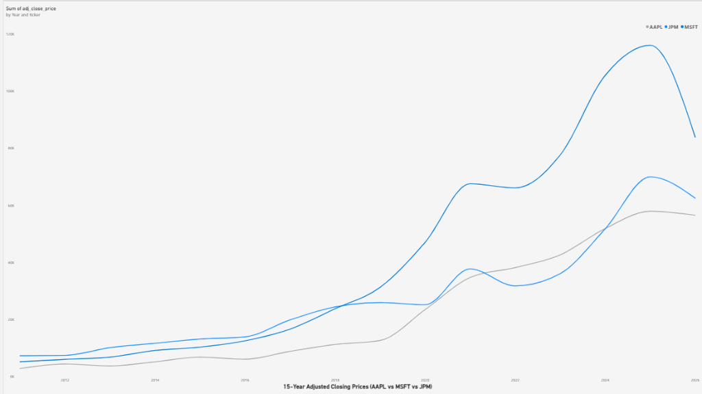

# 💹 Financial Analytics Platform

**End-to-End Financial Data Engineering & Valuation Platform**  
A production MySQL Star Schema data warehouse housing 15 years of daily market data (Stooq) and 10 years of SEC fundamentals (Macrotrends) for **Apple (AAPL)**, **Microsoft (MSFT)**, and **JPMorgan Chase (JPM)**, analyzed through 34 analytical SQL queries, visualized in **Power BI**, and delivered as an interactive **Streamlit web application** featuring a **10-Year DCF Model** and **5-Year Private Equity LBO Buyout Model**.

---

## 📊 Power BI Dashboard Preview

Recruiters and visitors do not need to install Power BI Desktop or download the .pbix file to see the analysis. Here is the 15-year comparative price trend built in Power BI:

> **Key Takeaway:** Demonstrates the 15-year comparative growth trajectory across tech giants (Apple, Microsoft) vs. the premier US diversified banking institution (JPMorgan Chase).

---

## 🚀 Live Interactive Web App :
https://finance-with-simran-financial-analytics-platform-app-b5bfja.streamlit.app/
- **Features:**
  - 📈 **Trading Charts:** 15-year interactive candlestick, SMA 50/200, and daily volume.
  - 📊 **Fundamentals:** 10-year trends for Revenue, Net Income, and Free Cash Flow.
  - ⚠️ **Risk & Portfolio Analytics:** Volatility, Sharpe ratio, underwater drawdown curves, and correlation matrix.
  - 💰 **10-Year DCF Valuation:** Live sliders for FCF growth, WACC, and terminal growth with instant intrinsic value recalculation.
  - 🏢 **5-Year LBO Model:** Private equity buyout schedule, debt paydown, MoIC, and sponsor IRR % returns.
  - 📚 **Financial Guide:** Plain-English guide demystifying Budgeting vs Forecasting vs DCF vs LBO.

---

## 🏗️ Architecture & Data Pipeline
1. **Data Ingestion:**
   - **Market Prices:** 15 years of daily OHLCV bars (~11,900 rows) from **Stooq**.
   - **Financial Statements:** 10 years of annual statements (FY2016–FY2025) from **Macrotrends**.
2. **MySQL 8 Star Schema:**
   - dim_companies: Corporate dimension entity.
   - act_prices: Daily time-series fact table.
   - act_fundamentals: Annual income & cash flow fact table.
3. **34 Analytical SQL Queries:** Window functions, CAGR, peak-to-trough drawdown, multi-asset correlation, and recursive CTE cash flow projections.
4. **Power BI & Streamlit UI:** BI reporting combined with interactive parameter simulation in Python.
